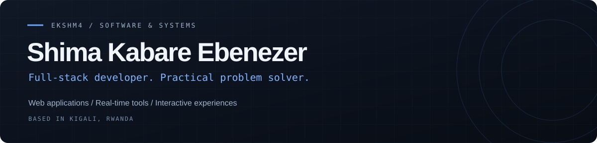

  

  <a href="https://shima-kabare-ebenezer.vercel.app/">Portfolio</a> &nbsp; / &nbsp;
  <a href="https://linkedin.com/in/shima-kabare-ebinezer-92b71437b">LinkedIn</a> &nbsp; / &nbsp;
  <a href="mailto:Shimaebinezer@gmail.com">Say hello</a>

## Hey, I'm Shima.

<a href="https://gifer.com/en/DVx4">
  <picture>
    <source media="(prefers-reduced-motion: reduce)" srcset="assets/scene-still.png" />
    
  </picture>
</a>

I'm a **full-stack developer based in Kigali, Rwanda**, studying Software Engineering at **African Leadership University · 2026–2029**.

I turn ideas into web applications, real-time tools, and interactive experiences. My work spans React interfaces, Node.js APIs, self-hosted systems, and AI integrations.

- **Building:** practical software for everyday problems.
- **Working with:** JavaScript, TypeScript, React, Next.js, and Express.
- **Exploring:** Python, desktop and mobile apps, and developer tools.
- **I care about:** clear interfaces, maintainable systems, and understanding the people using them.

 

Animation: <a href="https://gifer.com/en/DVx4">GIFER · DVx4</a>

## My toolkit

  
  
  
  
  
  

| Area | Technologies I use |
| :--- | :--- |
| **Web interfaces** | React · Next.js · TypeScript · Vite · Tailwind CSS · Radix UI |
| **Backend & real time** | Node.js · Express · REST APIs · Socket.IO · JWT |
| **Data & delivery** | MySQL · Prisma · Docker · Docker Compose · Nginx · Linux · Git |
| **Motion & maps** | Three.js · React Three Fiber · GSAP · Framer Motion · Leaflet |
| **AI & integrations** | LLM APIs · OpenRouter · Gemini · Business-system integrations |
| **Also exploring** | Python · Electron · Expo / React Native · VS Code extensions |

## Selected work

| Project | What it's about | Explore |
| :--- | :--- | :--- |
| **AccessPC** | Self-hosted media browsing and streaming, with React, Express, Prisma, and MySQL. | [Source](https://github.com/ekshm4/accessPc) |
| **E-SHIME** | A wellbeing application prototype with mood tracking, chat, and community interfaces. | [Source](https://github.com/ekshm4/e-shime) |
| **Kigali Smart Bus** | Interactive transit maps with simulated vehicle movement and routes. Frontend prototype; not live GPS. | [Source](https://github.com/ekshm4/smart-bus) |
| **FEGIS Odoo Guide** | A browser-based reference for Odoo screens and approval workflows. | [Live guide](https://fegis-odoo-approval-guide.vercel.app) · [Source](https://github.com/ekshm4/fegis-odoo-approval-guide) |
| **EPR Kigali Presbytery** | A responsive, public-facing community website exploration. | [Live site](https://epr3-site-sanctuary.vercel.app) · [Source](https://github.com/ekshm4/EPR3) |
| **SoftPi Website** | A marketing frontend built with Next.js, React, TypeScript, and Tailwind CSS. | [Source](https://github.com/ekshm4/softpi-website) |

More work, background, and contact details live on [my portfolio](https://shima-kabare-ebenezer.vercel.app/).

---

<strong>Have a useful idea or a problem worth solving?</strong> <a href="mailto:Shimaebinezer@gmail.com">Let's talk.</a>

